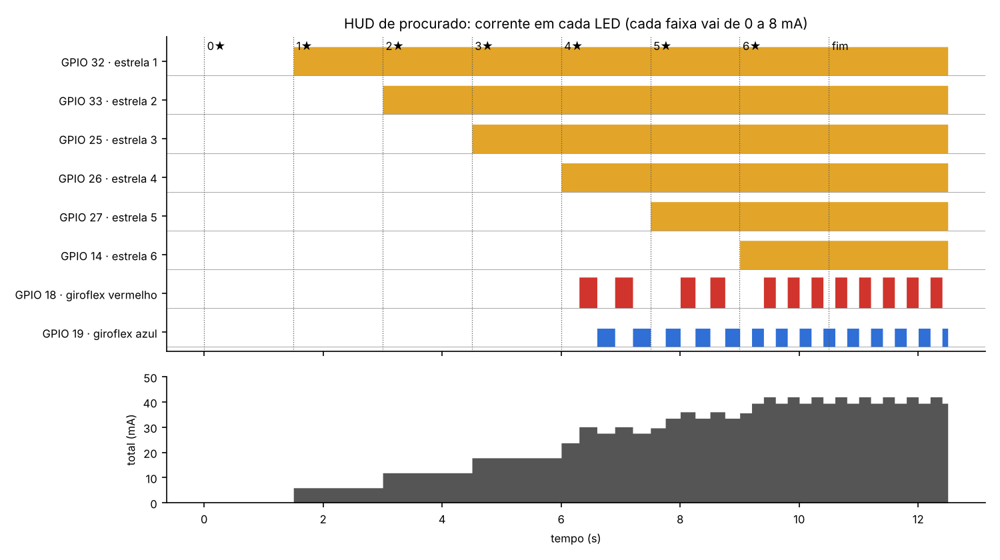

# ESP32 — guia de bancada

A implementação prática: `examples/procurado.cj` roda num ESP32 e o nível de procurado vira o pisca-pisca de um LED vermelho. Quanto mais estrelas, mais rápido ele pisca. Como o código é gerado, está em [geracao-de-codigo.md](geracao-de-codigo.md#esp32--micropython); aqui está como montar, gravar e conferir.

Ordem sugerida: [comprar](#1-lista-de-compras), testar no [Wokwi](#2-enquanto-a-placa-não-chega-wokwi) enquanto a placa não chega, depois [gravar o MicroPython](#3-gravar-o-micropython-na-placa), [montar](#4-montar-o-circuito) e [rodar](#5-rodar-o-programa).

## 1. Lista de compras

| Item | Qtd. | Observação |
|---|---|---|
| Placa **ESP32 DevKit V1** (ESP32-WROOM-32, 30 pinos) | 1 | tem um LED azul no GPIO 2: dá para testar antes de montar qualquer coisa |
| Cabo USB **de dados** | 1 | micro-USB na maioria das DevKit V1 (confira o conector). Cabo só de carga é o erro mais comum: a placa acende e o computador não a enxerga |
| LED vermelho 5 mm | 2–3 | um de reserva |
| Resistor 220 Ω (330 Ω também serve) | 2–3 | protege o LED e o pino |
| Protoboard (400 ou 830 furos) | 1 | a DevKit V1 é larga: numa protoboard comum sobra pouca fileira, então ligue a placa por jumpers se preciso |
| Jumpers macho-macho | 5–10 | |

Perto do conector USB da placa há um chip conversor, **CP2102** ou **CH340**. Anote qual é: se o computador não reconhecer a placa, é o driver dele que falta.

## 2. Enquanto a placa não chega: Wokwi

O [Wokwi](https://wokwi.com) simula ESP32 com MicroPython no navegador, com LED e resistor. Serve para ensaiar a demonstração e gravar o vídeo antes do hardware chegar.

1. Abra o template oficial: <https://wokwi.com/projects/new/micropython-esp32>. Ele já vem com a placa e o MicroPython configurados.
2. Gere o programa e cole no `main.py` do Wokwi, no lugar do que estiver lá:
   ```bash
   python -m grove examples/procurado.cj --esp32
   ```
   (ou copie da aba **Python → MicroPython · ESP32** do Grove Online)
3. Na aba `diagram.json`, **mantenha a placa como o template criou** e acrescente o LED e o resistor. Em `"parts"`:
   ```json
   { "type": "wokwi-resistor", "id": "r1", "top": 20, "left": 180, "attrs": { "value": "220" } },
   { "type": "wokwi-led", "id": "led1", "top": -40, "left": 280, "attrs": { "color": "red" } }
   ```
   E em `"connections"`:
   ```json
   [ "esp:2", "r1:1", "green", [] ],
   [ "r1:2", "led1:A", "green", [] ],
   [ "led1:C", "esp:GND.1", "black", [] ]
   ```
   `esp` é o `id` da placa no template; se lá estiver outro, use o de lá. Os pinos `2` e `GND.1` são os da ESP32-DevKitC V4, a placa que o Wokwi usa nos templates de ESP32. Se o template trouxer a DevKit V1, o pino é `D2`. Depois de colar, dá para arrastar as peças no desenho.
4. Aperte ▶. No monitor serial saem `1` a `6` e `fim: `; o LED fica apagado por 1,5 s e depois pisca cada vez mais rápido.

> Não consegui abrir o site do Wokwi do ambiente onde este guia foi escrito. Os nomes de peças e pinos vêm da documentação oficial ([wokwi-docs](https://github.com/wokwi/wokwi-docs), [wokwi-boards](https://github.com/wokwi/wokwi-boards)). Se o Wokwi reclamar de alguma conexão, refaça as ligações arrastando os fios no desenho.

## 3. Gravar o MicroPython na placa

Uma vez por placa. O jeito mais simples é pelo **Thonny** ([thonny.org](https://thonny.org)):

1. Ligue a placa no USB.
2. *Ferramentas → Opções → Interpretador*: escolha **MicroPython (ESP32)** e a porta da placa.
3. Clique em **Instalar ou atualizar o MicroPython**, escolha a variante **ESP32 / WROOM** e instale.

Pela linha de comando, com o [firmware ESP32_GENERIC](https://micropython.org/download/ESP32_GENERIC/) baixado:

```bash
pip install esptool
esptool.py --chip esp32 --port /dev/ttyUSB0 erase_flash
esptool.py --chip esp32 --port /dev/ttyUSB0 --baud 460800 write_flash -z 0x1000 ESP32_GENERIC-<versão>.bin
```

No Windows a porta é `COM3`, `COM4`…; no macOS, `/dev/cu.usbserial-…`. Nas versões novas do esptool o comando se chama `esptool` e as opções aceitam hífen (`erase-flash`, `write-flash`).

**Teste rápido, sem circuito:** no terminal do Thonny (ou `mpremote repl`), digite

```python
from machine import Pin
Pin(2, Pin.OUT).value(1)
```

O LED azul da placa acende. `.value(0)` apaga.

## 4. Montar o circuito

```
GPIO 2 ──[ resistor 220 Ω ]──▶|── GND
                         LED vermelho
                     (perna longa no resistor)
```

- Na DevKit V1, o GPIO 2 está marcado como **D2** na placa.
- A perna **longa** do LED (anodo, +) vai para o lado do resistor; a curta (catodo, −), para o **GND**.
- O LED azul da própria placa também está no GPIO 2: os dois vão piscar juntos, e está tudo certo.
- Para usar outro pino: `python -m grove examples/procurado.cj --esp32 --pino 4` e ligue o resistor no GPIO 4.

## 5. Rodar o programa

```bash
python -m grove examples/procurado.cj --esp32 > main.py
pip install mpremote
mpremote cp main.py :main.py     # grava na placa
mpremote reset                   # reinicia: o main.py roda sozinho
mpremote repl                    # ver a serial; Ctrl+] para sair
```

No Thonny: abra o `main.py`, *Arquivo → Salvar como → Dispositivo MicroPython*, com o nome `main.py`, e aperte o botão **EN** (reset) da placa.

**O que tem que acontecer:**

| Tempo | LED | Serial |
|---|---|---|
| 0 s | apagado (0 estrelas) | |
| 1,5 s | 1 estrela: troca a cada 600 ms | |
| 3 s | 2 estrelas: 300 ms | `1` |
| 4,5 s | 3 estrelas: 200 ms | `2` |
| 6 s | 4 estrelas: 150 ms | `3` |
| 7,5 s | 5 estrelas: 120 ms | `4` |
| 9 s | 6 estrelas: 100 ms | `5` |
| 10,5 s | continua em 100 ms | `6`, depois `fim: ` |

Cada número sai na serial 1,5 s depois de o LED mudar: o programa espera logo depois de cada valor novo de `estrelas` e só então chega ao `HELLOLADIES`.

## 6. Problemas comuns

| Sintoma | Causa provável | O que fazer |
|---|---|---|
| O computador não mostra porta nenhuma | cabo só de carga, ou driver faltando | troque o cabo; instale o driver CP210x ou CH340, conforme o chip da placa |
| `Failed to connect` / `Connecting....` sem fim ao gravar | a placa não entrou em modo de gravação | segure o botão **BOOT** enquanto aparece `Connecting...` |
| Programa roda, LED externo não acende | LED invertido, pino errado ou GND solto | vire o LED; confira D2 e GND; teste o LED com o código do teste rápido |
| LED da placa pisca, o externo não | o resistor ou o LED está numa fileira errada da protoboard | confira se as pernas estão em fileiras ligadas entre si |
| `ImportError: no module named 'machine'` | o `main.py` rodou no computador, não na placa | grave na placa (`mpremote cp`) em vez de rodar com `python` |
| Nada aparece na serial | outra janela usando a porta | feche o Thonny antes de usar o `mpremote`, e vice-versa |

## 7. Upgrade: o HUD de procurado

O circuito completo imita o canto da tela do GTA. Seis luzes amarelas mostram as estrelas de procurado, de 0 a 6. A partir de 4 estrelas, um par vermelho e azul começa a piscar alternado, como o giroflex da polícia, e acelera a cada estrela. O LED da própria placa continua piscando mais rápido conforme as estrelas, como no circuito simples.

```bash
python -m grove examples/procurado.cj --esp32 --hud > main.py
mpremote cp main.py :main.py && mpremote reset
```

(ou a aba **Python → ESP32 · HUD** do Grove Online)

### O que comprar a mais

| Item | Qtd. | Observação |
|---|---|---|
| LED amarelo 5 mm | 6 (+1 de reserva) | uma luz por estrela |
| LED azul 5 mm | 1 (+1 de reserva) | o vermelho do giroflex é o LED vermelho da lista de cima |
| Resistor de 220 Ω | 7 | 6 estrelas + o LED vermelho |
| Resistor de 100 Ω | 1 | para o LED azul, que precisa de mais tensão (veja abaixo) |
| Protoboard de 830 furos | 1 | ou duas pequenas: são 8 LEDs e 8 resistores |
| Jumpers macho-macho | ~20 | |

### Pinos

| Função | GPIO | Marcação na DevKit V1 | No Wokwi (DevKitC V4) |
|---|---|---|---|
| estrela 1 | 32 | D32 | `esp:32` |
| estrela 2 | 33 | D33 | `esp:33` |
| estrela 3 | 25 | D25 | `esp:25` |
| estrela 4 | 26 | D26 | `esp:26` |
| estrela 5 | 27 | D27 | `esp:27` |
| estrela 6 | 14 | D14 | `esp:14` |
| giroflex vermelho | 18 | D18 | `esp:18` |
| giroflex azul | 19 | D19 | `esp:19` |
| pisca da placa | 2 | D2 (LED azul da placa) | `esp:2` |
| terra de todos | GND | GND | `esp:GND.1` |

Na DevKit V1, os seis pinos das estrelas ficam lado a lado na mesma borda da placa. São GPIOs seguros para saída: nenhum deles é de boot, de memória ou só de entrada.

### Montagem

Cada um dos oito LEDs é ligado igual ao do circuito simples:

```
GPIO ──[ resistor ]──▶|── GND
                    LED
          (perna longa no resistor)
```

- Ligue um GND da placa à fileira azul (−) da protoboard e ponha as pernas curtas dos oito LEDs nela: um terra só para todos.
- **O LED azul é mais fraco.** Ele precisa de quase 3 V para acender, e a placa dá 3,3 V. Por isso o resistor dele é de 100 Ω, não 220 Ω, e mesmo assim ele brilha menos que o vermelho. Se ficar fraco demais, use um LED azul de alto brilho. Não ligue LED nenhum direto no pino, sem resistor.
- Os amarelos e o vermelho com 220 Ω ficam em uns 5 a 6 mA cada, bem dentro do que um pino aguenta.

### O que tem que acontecer com o `procurado.cj`

| Estrelas | Luzes amarelas | Giroflex | LED da placa |
|---|---|---|---|
| 0 | nenhuma | apagado | apagado |
| 1 a 3 | 1 a 3 acesas | apagado | 600, 300, 200 ms |
| 4 | 4 acesas | troca a cada 300 ms | 150 ms |
| 5 | 5 acesas | 250 ms | 120 ms |
| 6 | todas | 200 ms | 100 ms |

Cada nível dura 1,5 s. No fim, as seis ficam acesas e o giroflex continua piscando até a placa ser reiniciada.

### No Wokwi

No projeto do template de MicroPython (seção 2), cole o programa do `--esp32 --hud` no `main.py` e acrescente ao `diagram.json`, dentro de `"parts"`:

```json
{"type": "wokwi-resistor", "id": "r1", "top": 60, "left": 160, "rotate": 90, "attrs": {"value": "220"}},
{"type": "wokwi-led", "id": "led1", "top": -10, "left": 180, "attrs": {"color": "yellow"}},
{"type": "wokwi-resistor", "id": "r2", "top": 60, "left": 198, "rotate": 90, "attrs": {"value": "220"}},
{"type": "wokwi-led", "id": "led2", "top": -10, "left": 218, "attrs": {"color": "yellow"}},
{"type": "wokwi-resistor", "id": "r3", "top": 60, "left": 236, "rotate": 90, "attrs": {"value": "220"}},
{"type": "wokwi-led", "id": "led3", "top": -10, "left": 256, "attrs": {"color": "yellow"}},
{"type": "wokwi-resistor", "id": "r4", "top": 60, "left": 274, "rotate": 90, "attrs": {"value": "220"}},
{"type": "wokwi-led", "id": "led4", "top": -10, "left": 294, "attrs": {"color": "yellow"}},
{"type": "wokwi-resistor", "id": "r5", "top": 60, "left": 312, "rotate": 90, "attrs": {"value": "220"}},
{"type": "wokwi-led", "id": "led5", "top": -10, "left": 332, "attrs": {"color": "yellow"}},
{"type": "wokwi-resistor", "id": "r6", "top": 60, "left": 350, "rotate": 90, "attrs": {"value": "220"}},
{"type": "wokwi-led", "id": "led6", "top": -10, "left": 370, "attrs": {"color": "yellow"}},
{"type": "wokwi-resistor", "id": "r7", "top": 60, "left": 418, "rotate": 90, "attrs": {"value": "220"}},
{"type": "wokwi-led", "id": "led7", "top": -10, "left": 438, "attrs": {"color": "red"}},
{"type": "wokwi-resistor", "id": "r8", "top": 60, "left": 456, "rotate": 90, "attrs": {"value": "100"}},
{"type": "wokwi-led", "id": "led8", "top": -10, "left": 476, "attrs": {"color": "blue"}}
```

E dentro de `"connections"`:

```json
["esp:32", "r1:1", "green", []],
["r1:2", "led1:A", "green", []],
["led1:C", "esp:GND.1", "black", []],
["esp:33", "r2:1", "green", []],
["r2:2", "led2:A", "green", []],
["led2:C", "esp:GND.1", "black", []],
["esp:25", "r3:1", "green", []],
["r3:2", "led3:A", "green", []],
["led3:C", "esp:GND.1", "black", []],
["esp:26", "r4:1", "green", []],
["r4:2", "led4:A", "green", []],
["led4:C", "esp:GND.1", "black", []],
["esp:27", "r5:1", "green", []],
["r5:2", "led5:A", "green", []],
["led5:C", "esp:GND.1", "black", []],
["esp:14", "r6:1", "green", []],
["r6:2", "led6:A", "green", []],
["led6:C", "esp:GND.1", "black", []],
["esp:18", "r7:1", "green", []],
["r7:2", "led7:A", "green", []],
["led7:C", "esp:GND.1", "black", []],
["esp:19", "r8:1", "green", []],
["r8:2", "led8:A", "green", []],
["led8:C", "esp:GND.1", "black", []]
```

Como na seção 2, `esp` é o `id` da placa no template. As posições são só um ponto de partida: arraste as peças no desenho se quiser arrumar.

### Simulação elétrica (ngspice, o mesmo motor do EasyEDA)

Antes de comprar e montar, dá para conferir o circuito no simulador. A pasta `hardware/` tem o circuito em SPICE e um script que testa o circuito e o programa juntos:

```bash
sudo apt install ngspice          # uma vez (no Windows/Mac: ngspice.sourceforge.io)
ngspice -b hardware/hud.cir       # só o circuito: os 8 LEDs acesos
python hardware/testar_circuito.py --figura docs/img/simulacao-hud.png
```

A ESP32 não entra na simulação elétrica: cada GPIO em nível alto vira uma fonte de 3,3 V. Os LEDs são modelos de LED genérico de 5 mm (`hardware/leds.lib`), ajustados a valores típicos de datasheet, não às peças que vocês vão comprar.

**1. Cada LED aceso.** No pior caso, o pino dá só 3,0 V, o resistor está 5% acima e o LED pede mais tensão. O critério é ficar entre 1 mA, para o LED ser bem visível numa sala, e 20 mA, a força padrão do pino e a corrente nominal do LED.

| LED | Resistor | Tensão no LED | Corrente típica | Pior caso | Máximo | Potência no resistor |
|---|---|---|---|---|---|---|
| amarelo | 220 Ω | 1,99 V | 5,94 mA | 3,39 mA | 6,24 mA | 8,1 mW |
| vermelho | 220 Ω | 1,90 V | 6,37 mA | 4,17 mA | 6,69 mA | 9,3 mW |
| azul | 100 Ω | 2,92 V | 3,82 mA | 1,17 mA | 3,96 mA | 1,5 mW |
| azul com 220 Ω (só comparação) | 220 Ω | 2,82 V | 2,16 mA | **0,81 mA** | 2,24 mA | 1,1 mW |

É por isso que o azul leva 100 Ω: com 220 Ω, no pior caso, ele fica abaixo de 1 mA. Mesmo com 100 Ω, a folga dele é pequena, e o LED azul de alto brilho é a garantia. Os resistores de 1/4 W (250 mW) sobram.

**2. O programa e o circuito juntos.** O script gera o MicroPython do `procurado.cj` com `--esp32 --hud` e roda numa placa de mentira com relógio virtual, onde os timers disparam no tempo certo. O que cada pino fez vira uma fonte no ngspice, que simula os 12,5 s do programa. As conferências são feitas na corrente dos LEDs:

| Tempo | Estrelas | LEDs amarelos acesos | Giroflex | Corrente total |
|---|---|---|---|---|
| 0 s | 0 | 0 | apagado | 0 mA |
| 1,5 s | 1 | 1 | apagado | 5,9 mA |
| 3,0 s | 2 | 2 | apagado | 11,9 mA |
| 4,5 s | 3 | 3 | apagado | 17,8 mA |
| 6,0 s | 4 | 4 | alterna a cada 300 ms | até 30,2 mA |
| 7,5 s | 5 | 5 | 250 ms | até 36,1 mA |
| 9,0 s | 6 | 6 | 200 ms | até 42,0 mA |

Em nenhum instante o vermelho e o azul conduzem juntos. A corrente total nunca passa de 42 mA, uns 6 mA por pino, longe do limite de cada pino e do que o regulador de 3,3 V da placa fornece. O LED da própria placa, no GPIO 2, fica de fora: o circuito dele é o da placa.



**O teste reprova circuito ou código errado.** Antes de confiar nele, foi rodado com defeitos de propósito: azul com resistor de 10 kΩ, um LED amarelo sem corrente, o giroflex acendendo os dois juntos, o período errado, uma estrela a mais. Os cinco foram reprovados.

#### No EasyEDA

Pela documentação oficial, o EasyEDA Pro simula desde a versão 3.2, com dois motores: NGSpice e SimulIDE. Escolham o NGSpice, o mesmo usado aqui. A edição Std também tem modo de simulação. O EasyEDA não roda o programa da ESP32: lá também cada pino vira uma fonte. Para repetir o teste 1:

1. Num esquemático de simulação, monte um ramo: fonte de tensão DC de 3,3 V → resistor de 220 Ω → LED → terra.
2. Use o LED da biblioteca de simulação, ou cole como diretiva SPICE a linha `.model` correspondente de `hardware/leds.lib`. O EasyEDA não aceita `.include`, então tem que ser a linha em si.
3. Rode o ponto de operação (ou um transiente curto) e leia a corrente na fonte.
4. Repita com o LED azul e o resistor de 100 Ω, e depois com 220 Ω, para ver a diferença.

Para ver o ritmo do giroflex com 4 estrelas, troque as fontes DC do vermelho e do azul por pulsos e rode um transiente de 3 s:

```
vermelho: PULSE(0 3.3 0    1u 1u 300m 600m)
azul:     PULSE(0 3.3 300m 1u 1u 300m 600m)
```

Com o LED da biblioteca do EasyEDA, as correntes podem sair um pouco diferentes das da tabela, porque o modelo é outro. O que importa é o critério: entre 1 e 20 mA, e o vermelho e o azul nunca juntos.

> Não consegui abrir o EasyEDA do ambiente onde este guia foi escrito (a rede bloqueia o site). Os resultados acima são do ngspice 42; o nome dos menus pode variar entre as edições do EasyEDA.

## 8. Para a entrega

- [ ] Foto do circuito montado
- [ ] Opcional: print do teste no EasyEDA, ao lado da tabela da simulação elétrica (seção 7)
- [ ] Vídeo curto do LED acelerando, com a serial na tela (é a cena 9 do [roteiro do vídeo](roteiro-video.md))
- [ ] Preencher no artigo o parágrafo "Teste na placa": modelo da placa, pino usado, se o LED se comportou como na tabela da seção 5
