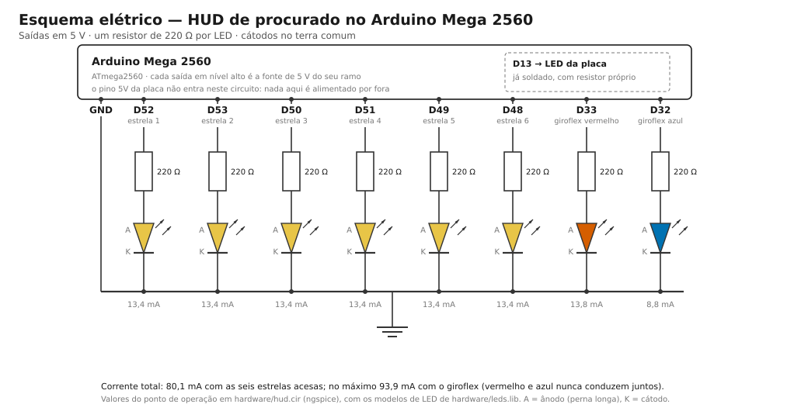
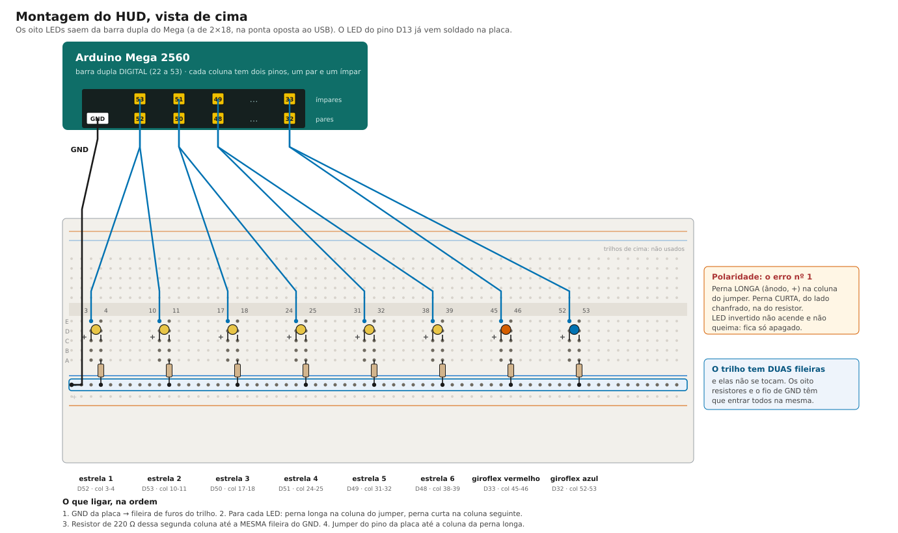

# Arduino Mega 2560 — guia de bancada

A implementação prática: `examples/procurado.cj` roda num Arduino Mega 2560 e o nível de procurado vira o pisca-pisca de um LED. Quanto mais estrelas, mais rápido ele pisca. Como o código é gerado, está em [geracao-de-codigo.md](geracao-de-codigo.md#arduino--mega-2560); aqui está como montar, compilar e conferir.

Ordem sugerida: [comprar](#1-lista-de-compras), testar no [Wokwi](#2-enquanto-a-placa-não-chega-wokwi) enquanto a placa não chega, depois [instalar o arduino-cli](#3-instalar-o-compilador), [montar](#4-montar-o-circuito) e [rodar](#5-rodar-o-programa).

## 1. Lista de compras

| Item | Qtd. | Observação |
|---|---|---|
| Placa **Arduino Mega 2560 R3** | 1 | tem um LED soldado no pino 13: dá para testar antes de montar qualquer coisa. Clone com CH340 serve |
| Cabo USB **de dados**, tipo B | 1 | o conector quadrado, de impressora; quase sempre vem junto com a placa. Cabo só de carga é o erro mais comum: a placa acende e o computador não a enxerga |
| LED vermelho 5 mm | 2–3 | um de reserva |
| Resistor 220 Ω (330 Ω também serve) | 2–3 | protege o LED e o pino |
| Protoboard (400 ou 830 furos) | 1 | a placa não entra na protoboard: ela fica ao lado, ligada por jumpers |
| Jumpers macho-macho | 5–10 | |

Preço do conjunto e divisão por pessoa: a placa com o cabo sai por volta de R$ 142 no Pix ([Eletrogate](https://www.eletrogate.com/mega-2560-r3-ch340-cabo-usb-para-arduino), [Saravati](https://www.saravati.com.br/arduino-mega-2560-com-chip-ch340-com-cabo-usb.html), cotados em 04/11/2026); o resto da lista, uns R$ 17.

Perto do conector USB há o chip conversor: **ATmega16U2** na placa original, **CH340** nos clones. Anote qual é: ele decide o nome da porta e, no Windows, qual driver instalar.

## 2. Enquanto a placa não chega: Wokwi

O [Wokwi](https://wokwi.com) simula o Mega 2560 no navegador, com LED e resistor. Serve para ensaiar a demonstração e gravar o vídeo antes do hardware chegar. Como o alvo da Grove agora é C++, o sketch gerado vai direto, sem adaptação.

1. Abra o template oficial: <https://wokwi.com/projects/new/arduino-mega>.
2. Gere o programa e cole no `sketch.ino` do Wokwi, no lugar do que estiver lá:
   ```bash
   python -m grove examples/procurado.cj --mega
   ```
   (ou copie da aba **Arduino · Mega 2560** do Grove Online)
3. Na aba `diagram.json`, **mantenha a placa como o template criou** e acrescente o LED e o resistor. Em `"parts"`:
   ```json
   { "type": "wokwi-resistor", "id": "r1", "top": 20, "left": 180, "attrs": { "value": "220" } },
   { "type": "wokwi-led", "id": "led1", "top": -40, "left": 280, "attrs": { "color": "red" } }
   ```
   E em `"connections"`:
   ```json
   [ "mega:13", "r1:1", "green", [] ],
   [ "r1:2", "led1:A", "green", [] ],
   [ "led1:C", "mega:GND.1", "black", [] ]
   ```
   `mega` é o `id` da placa no template; se lá estiver outro, use o de lá.
4. Aperte ▶. No monitor serial saem `1` a `6` e `fim: `; o LED fica apagado por 1,5 s e depois pisca cada vez mais rápido.

> Não consegui abrir o site do Wokwi do ambiente onde este guia foi escrito. Os nomes de peças e pinos vêm da documentação oficial ([wokwi-docs](https://github.com/wokwi/wokwi-docs), [wokwi-boards](https://github.com/wokwi/wokwi-boards)). Se o Wokwi reclamar de alguma conexão, refaça as ligações arrastando os fios no desenho.

## 3. Instalar o compilador

O Mega 2560 não leva interpretador nenhum: o sketch é compilado no computador e gravado já em código de máquina. Uma vez por computador, não por placa.

```bash
# Arch / CachyOS: pacman -S arduino-cli      Debian/Ubuntu: veja arduino.github.io/arduino-cli
arduino-cli core install arduino:avr   # baixa o avr-gcc e as bibliotecas; algumas centenas de MB
arduino-cli board list                 # com a placa ligada: mostra a porta e confirma a FQBN
```

No Linux, a porta serial pertence ao grupo `uucp` (em algumas distribuições, `dialout`). Sem estar no grupo, o upload falha com `Permission denied` mesmo com tudo certo:

```bash
sudo usermod -aG uucp $USER   # depois relogue; id -nG confirma
```

Quem preferir clicar usa a [IDE do Arduino](https://www.arduino.cc/en/software), que já vem com o core AVR: *Ferramentas → Placa → Arduino Mega or Mega 2560*, processador *ATmega2560*.

**Teste rápido, sem circuito:** grave o exemplo `Blink` (na IDE, *Arquivo → Exemplos → 01.Basics → Blink*). O LED da placa, no pino 13, pisca a cada segundo.

## 4. Montar o circuito

```
pino 13 ──[ resistor 220 Ω ]──▶|── GND
                           LED vermelho
                       (perna longa no resistor)
```

- A perna **longa** do LED (ânodo, +) vai para o lado do resistor; a curta (cátodo, −), para o **GND**.
- O LED que já vem soldado na placa também está no pino 13: os dois vão piscar juntos, e está tudo certo.
- A placa tem três pinos **GND**; qualquer um serve.
- Para usar outro pino: `python -m grove examples/procurado.cj --mega --pino 4` e ligue o resistor no pino 4.

## 5. Rodar o programa

O `arduino-cli` exige que o sketch esteja numa pasta com o mesmo nome do arquivo:

```bash
mkdir -p procurado
python -m grove examples/procurado.cj --mega > procurado/procurado.ino
arduino-cli compile --fqbn arduino:avr:mega:cpu=atmega2560 procurado
arduino-cli upload  --fqbn arduino:avr:mega:cpu=atmega2560 -p /dev/ttyUSB0 procurado
arduino-cli monitor -p /dev/ttyUSB0 --config baudrate=115200   # ver a serial; Ctrl+C para sair
```

A porta é `/dev/ttyUSB0` nos clones com CH340, `/dev/ttyACM0` na placa original; `arduino-cli board list` diz qual. No Windows é `COM3`, `COM4`…

Na IDE: cole o sketch, *Sketch → Carregar*, e abra o **Monitor Serial em 115200**.

**O que tem que acontecer:**

| Tempo | LED | Serial |
|---|---|---|
| 0 s | apagado (0 estrelas) | |
| 1,5 s | 1 estrela: troca a cada 600 ms | |
| 3 s | 2 estrelas: 300 ms | `1` |
| 4,5 s | 3 estrelas: 200 ms | `2` |
| 6 s | 4 estrelas: 150 ms | `3` |
| 7,5 s | 5 estrelas: 120 ms | `4` |
| 9 s | 6 estrelas: 100 ms | `5` |
| 10,5 s | continua em 100 ms | `6`, depois `fim: ` |

Cada número sai na serial 1,5 s depois de o LED mudar: o programa espera logo depois de cada valor novo de `estrelas` e só então chega ao `HELLOLADIES`.

O programa roda uma vez: está todo dentro do `setup()`. Quando ele acaba, o `loop()` segue piscando o LED no ritmo do último nível, até a placa ser reiniciada. Para repetir desde o começo, aperte o botão de **reset** — ou abra o Monitor Serial, que reinicia a placa ao conectar.

## 6. Problemas comuns

| Sintoma | Causa provável | O que fazer |
|---|---|---|
| O computador não mostra porta nenhuma | cabo só de carga, ou driver faltando | troque o cabo; instale o driver CH340, se a placa for clone |
| `arduino-cli board list` não imprime nada | o `arduino-cli` não está instalado | `sudo pacman -S arduino-cli` (Arch/CachyOS); um comando que não existe não imprime tabela nenhuma |
| `Permission denied` em `/dev/ttyUSB0` | a porta é do grupo `uucp` e você não está nele | `sudo usermod -aG uucp $USER`, depois **relogar**; `id -nG` confirma. Para a sessão atual, `newgrp uucp` |
| `avrdude: ser_open(): can't open device` | outra janela segurando a porta | feche o Monitor Serial antes de gravar |
| `programmer is not responding` | FQBN errada, ou a placa é uma Mega antiga | confira `arduino-cli board list`; nas placas bem velhas o processador é `atmega1280` |
| Grava, mas a serial não mostra nada | baud errado no monitor | o programa abre a serial em **115200** |
| As primeiras linhas da serial somem | o monitor abriu depois de o programa começar | normal: abrir a porta reinicia a placa, então abra o monitor e aperte reset |
| Programa roda, LED externo não acende | LED invertido, pino errado ou GND solto | vire o LED; confira o pino 13 e o GND; teste com o `Blink` |
| LED da placa pisca, o externo não | o resistor ou o LED está numa fileira errada da protoboard | confira se as pernas estão em fileiras ligadas entre si |

## 7. Upgrade: o HUD de procurado

O circuito completo imita o canto da tela do GTA. Seis luzes amarelas mostram as estrelas de procurado, de 0 a 6. A partir de 4 estrelas, um par vermelho e azul começa a piscar alternado, como o giroflex da polícia, e acelera a cada estrela. O LED da própria placa continua piscando mais rápido conforme as estrelas, como no circuito simples.

```bash
mkdir -p hud
python -m grove examples/procurado.cj --mega --hud > hud/hud.ino
arduino-cli compile --fqbn arduino:avr:mega:cpu=atmega2560 hud
arduino-cli upload  --fqbn arduino:avr:mega:cpu=atmega2560 -p /dev/ttyUSB0 hud
```

(ou a aba **Mega 2560 · HUD** do Grove Online)

### O que comprar a mais

| Item | Qtd. | Observação |
|---|---|---|
| LED amarelo 5 mm | 6 (+1 de reserva) | uma luz por estrela |
| LED azul 5 mm | 1 (+1 de reserva) | o vermelho do giroflex é o LED vermelho da lista de cima |
| Resistor de 220 Ω | 8 | um para cada LED; nos 5 V do Mega o azul também usa 220 Ω |
| Protoboard de 830 furos | 1 | ou duas pequenas: são 8 LEDs e 8 resistores |
| Jumpers macho-macho | ~20 | |

### Pinos

| Função | Pino | Marcação na placa | No Wokwi |
|---|---|---|---|
| estrela 1 | 52 | D52 | `mega:52` |
| estrela 2 | 53 | D53 | `mega:53` |
| estrela 3 | 50 | D50 | `mega:50` |
| estrela 4 | 51 | D51 | `mega:51` |
| estrela 5 | 49 | D49 | `mega:49` |
| estrela 6 | 48 | D48 | `mega:48` |
| giroflex vermelho | 33 | D33 | `mega:33` |
| giroflex azul | 32 | D32 | `mega:32` |
| pisca da placa | 13 | D13 (LED soldado) | `mega:13` |
| terra de todos | GND | GND | `mega:GND.1` |

Oito dos nove pinos ficam na **barra dupla** do Mega, a de 2×18 na ponta oposta ao USB: ali 52 e 53 são vizinhos de coluna, assim como 50/51, 48/49 e 32/33 — um par por LED do giroflex e um par por duas estrelas. Os pinos 0 e 1 ficam de fora de propósito: são a serial da USB, por onde sai o `HELLOLADIES`. Trocar esses números é mudar `PINOS_ESTRELAS`, `PINO_VERMELHO` e `PINO_AZUL` em `grove/codegen_ino.py`: o gerador, os testes e os desenhos leem todos de lá.

### Montagem



Cada um dos oito LEDs é ligado igual ao do circuito simples: pino → resistor de 220 Ω → ânodo do LED, cátodo no terra.

E a mesma coisa montada, vista de cima:



Na protoboard, cada LED ocupa duas colunas: o ânodo na coluna do jumper, o cátodo na seguinte, de onde o resistor desce para o trilho. Deixe pelo menos uma coluna livre entre um LED e o próximo, para as pernas não se encostarem.

**O erro nº 1, medido na bancada: LED invertido.** Foi o que segurou a primeira montagem deste circuito. Perna **longa** (ânodo) na coluna do jumper, perna **curta** — a do lado chanfrado do encapsulamento — na coluna do resistor. Um LED invertido não queima nem avisa: fica apagado, igualzinho a um fio solto. E como é fácil montar os oito do mesmo jeito errado, o sintoma é a placa inteira apagada, o que parece defeito de software.

**O erro nº 2:** o trilho de alimentação tem **duas fileiras de furos**, uma do lado da linha azul e outra do lado da vermelha, e elas são tiras de metal **separadas**. Os oito resistores e o fio de GND têm que entrar todos na mesma.

Para separar um do outro quando nada acende: ligue um LED solto, fora da protoboard, entre o **5V** e o **GND** da placa, com o resistor em série. Se ele só acender num dos sentidos, você acabou de descobrir qual é o lado certo — e aí é só repetir na protoboard.

Os dois desenhos saem de `python hardware/gerar_esquema.py` e `python hardware/gerar_montagem.py`, que leem os pinos do próprio `grove/codegen_ino.py` — mudar lá muda os desenhos.

- Ligue um GND da placa à fileira azul (−) da protoboard e ponha as pernas curtas dos oito LEDs nela: um terra só para todos.
- **O pino 5V não entra.** Cada LED é alimentado pelo próprio pino digital, que em nível alto entrega os 5 V — é isso que o `digitalWrite(pino, HIGH)` faz. O único fio que sai da placa fora dos oito de sinal é o GND. A fileira vermelha (+) da protoboard fica vazia. O pino 5V serve para alimentar coisas que o pino não aguenta (motor, fita de LED, display), e aí entra um transistor no meio; aqui os oito LEDs somam 94 mA e saem direto dos pinos.
- Nos 5 V do Mega todos os oito resistores são de 220 Ω, inclusive o do azul. No ESP32, que trabalha com 3,3 V, o azul precisava de 100 Ω para acender; aqui 100 Ω jogaria o azul para 18 mA, em cima do limite do pino. Com 220 Ω ele fica em 8,8 mA, bem visível.
- Nunca ligue LED direto no pino, sem resistor.

### O que tem que acontecer com o `procurado.cj`

| Estrelas | Luzes amarelas | Giroflex | LED da placa |
|---|---|---|---|
| 0 | nenhuma | apagado | apagado |
| 1 a 3 | 1 a 3 acesas | apagado | 600, 300, 200 ms |
| 4 | 4 acesas | troca a cada 300 ms | 150 ms |
| 5 | 5 acesas | 250 ms | 120 ms |
| 6 | todas | 200 ms | 100 ms |

Cada nível dura 1,5 s. No fim, as seis ficam acesas e o giroflex continua piscando até a placa ser reiniciada.

### No Wokwi

No projeto do template do Mega (seção 2), cole o programa do `--mega --hud` no `sketch.ino` e acrescente ao `diagram.json`, dentro de `"parts"`:

```json
{"type": "wokwi-resistor", "id": "r1", "top": 60, "left": 160, "rotate": 90, "attrs": {"value": "220"}},
{"type": "wokwi-led", "id": "led1", "top": -10, "left": 180, "attrs": {"color": "yellow"}},
{"type": "wokwi-resistor", "id": "r2", "top": 60, "left": 198, "rotate": 90, "attrs": {"value": "220"}},
{"type": "wokwi-led", "id": "led2", "top": -10, "left": 218, "attrs": {"color": "yellow"}},
{"type": "wokwi-resistor", "id": "r3", "top": 60, "left": 236, "rotate": 90, "attrs": {"value": "220"}},
{"type": "wokwi-led", "id": "led3", "top": -10, "left": 256, "attrs": {"color": "yellow"}},
{"type": "wokwi-resistor", "id": "r4", "top": 60, "left": 274, "rotate": 90, "attrs": {"value": "220"}},
{"type": "wokwi-led", "id": "led4", "top": -10, "left": 294, "attrs": {"color": "yellow"}},
{"type": "wokwi-resistor", "id": "r5", "top": 60, "left": 312, "rotate": 90, "attrs": {"value": "220"}},
{"type": "wokwi-led", "id": "led5", "top": -10, "left": 332, "attrs": {"color": "yellow"}},
{"type": "wokwi-resistor", "id": "r6", "top": 60, "left": 350, "rotate": 90, "attrs": {"value": "220"}},
{"type": "wokwi-led", "id": "led6", "top": -10, "left": 370, "attrs": {"color": "yellow"}},
{"type": "wokwi-resistor", "id": "r7", "top": 60, "left": 418, "rotate": 90, "attrs": {"value": "220"}},
{"type": "wokwi-led", "id": "led7", "top": -10, "left": 438, "attrs": {"color": "red"}},
{"type": "wokwi-resistor", "id": "r8", "top": 60, "left": 456, "rotate": 90, "attrs": {"value": "220"}},
{"type": "wokwi-led", "id": "led8", "top": -10, "left": 476, "attrs": {"color": "blue"}}
```

E dentro de `"connections"`:

```json
["mega:2", "r1:1", "green", []],
["r1:2", "led1:A", "green", []],
["led1:C", "mega:GND.1", "black", []],
["mega:3", "r2:1", "green", []],
["r2:2", "led2:A", "green", []],
["led2:C", "mega:GND.1", "black", []],
["mega:4", "r3:1", "green", []],
["r3:2", "led3:A", "green", []],
["led3:C", "mega:GND.1", "black", []],
["mega:5", "r4:1", "green", []],
["r4:2", "led4:A", "green", []],
["led4:C", "mega:GND.1", "black", []],
["mega:6", "r5:1", "green", []],
["r5:2", "led5:A", "green", []],
["led5:C", "mega:GND.1", "black", []],
["mega:7", "r6:1", "green", []],
["r6:2", "led6:A", "green", []],
["led6:C", "mega:GND.1", "black", []],
["mega:8", "r7:1", "green", []],
["r7:2", "led7:A", "green", []],
["led7:C", "mega:GND.1", "black", []],
["mega:9", "r8:1", "green", []],
["r8:2", "led8:A", "green", []],
["led8:C", "mega:GND.1", "black", []]
```

Como na seção 2, `mega` é o `id` da placa no template. As posições são só um ponto de partida: arraste as peças no desenho se quiser arrumar.

### Simulação elétrica (ngspice, o mesmo motor do EasyEDA)

Antes de comprar e montar, dá para conferir o circuito no simulador. A pasta `hardware/` tem o circuito em SPICE e um script que mede cada ramo:

```bash
sudo apt install ngspice          # uma vez (no Windows/Mac: ngspice.sourceforge.io)
ngspice -b hardware/hud.cir       # os 8 LEDs acesos ao mesmo tempo
python hardware/testar_circuito.py
```

O Mega não entra na simulação elétrica: cada pino em nível alto vira uma fonte de 5 V. Os LEDs são modelos de LED genérico de 5 mm (`hardware/leds.lib`), ajustados a valores típicos de datasheet, não às peças que vocês vão comprar.

**Cada LED aceso.** No pior caso, o pino dá só 4,5 V com carga, o resistor está 5% acima e o LED pede mais tensão. O critério é ficar entre 1 mA, para o LED ser bem visível numa sala, e 20 mA, a corrente recomendada do pino do ATmega2560 e a nominal do LED.

| LED | Resistor | Tensão no LED | Corrente típica | Pior caso | Máxima | Potência no resistor |
|---|---|---|---|---|---|---|
| amarelo | 220 Ω | 2,05 V | 13,35 mA | 9,44 mA | 14,04 mA | 39,2 mW |
| vermelho | 220 Ω | 1,95 V | 13,80 mA | 10,27 mA | 14,50 mA | 41,9 mW |
| azul | 220 Ω | 3,05 V | 8,83 mA | 5,78 mA | 9,26 mA | 17,2 mW |
| azul com 100 Ω (o do ESP32) | 100 Ω | 3,16 V | 18,17 mA | 11,49 mA | **19,04 mA** | 33,0 mW |

A última linha é o que mudou com a placa: nos 3,3 V do ESP32 o azul precisava de 100 Ω para passar de 1 mA; nos 5 V do Mega, 100 Ω o levam a 18 mA, encostando no limite do pino. Com 220 Ω ele fica em 8,8 mA e a lista de compras fica com um resistor só. Os resistores de 1/4 W (250 mW) sobram com folga.

**Corrente total.** Seis amarelos acesos dão 80,1 mA; com o giroflex, no máximo 93,9 mA (vermelho e azul nunca conduzem juntos). Cada pino fica em uns 14 mA, abaixo dos 20 mA recomendados, e os nove pinos estão espalhados pelos bancos B, E, G e H do ATmega2560, então nenhum banco chega perto do limite de 100 mA. O LED da própria placa, no pino 13, já tem o resistor dele soldado.

#### No EasyEDA

Pela documentação oficial, o EasyEDA Pro simula desde a versão 3.2, com dois motores: NGSpice e SimulIDE. Escolham o NGSpice, o mesmo usado aqui. A edição Std também tem modo de simulação. O EasyEDA não roda o sketch do Mega: lá também cada pino vira uma fonte. Para repetir a tabela:

1. Num esquemático de simulação, monte um ramo: fonte de tensão DC de 5 V → resistor de 220 Ω → LED → terra.
2. Use o LED da biblioteca de simulação, ou cole como diretiva SPICE a linha `.model` correspondente de `hardware/leds.lib`. O EasyEDA não aceita `.include`, então tem que ser a linha em si.
3. Rode o ponto de operação (ou um transiente curto) e leia a corrente na fonte.
4. Repita com o LED azul, com 220 Ω e com 100 Ω, para ver por que o de 100 Ω ficou para trás.

Para ver o ritmo do giroflex com 4 estrelas, troque as fontes DC do vermelho e do azul por pulsos e rode um transiente de 3 s:

```
vermelho: PULSE(0 5 0    1u 1u 300m 600m)
azul:     PULSE(0 5 300m 1u 1u 300m 600m)
```

Com o LED da biblioteca do EasyEDA, as correntes podem sair um pouco diferentes das da tabela, porque o modelo é outro. O que importa é o critério: entre 1 e 20 mA, e o vermelho e o azul nunca juntos.

> Não consegui abrir o EasyEDA do ambiente onde este guia foi escrito (a rede bloqueia o site). O nome dos menus pode variar entre as edições.

## 8. Ligar no GTA de verdade

Até aqui o próprio programa inventa os níveis. Para o jogo mandar o nível de procurado pela USB, são mais duas peças (um script CLEO e uma ponte em Python) e um cheat novo, o `CJPHONEHOME`: tudo em [gta.md](gta.md).

## 9. Para a entrega

- [ ] Foto do circuito montado
- [ ] Opcional: print do teste no EasyEDA, ao lado da tabela da simulação elétrica (seção 7)
- [ ] Vídeo curto do LED acelerando, com a serial na tela (é a cena 9 do [roteiro do vídeo](roteiro-video.md))
- [ ] Preencher no artigo o parágrafo "Teste na placa": modelo da placa, pino usado, se o LED se comportou como na tabela da seção 5
